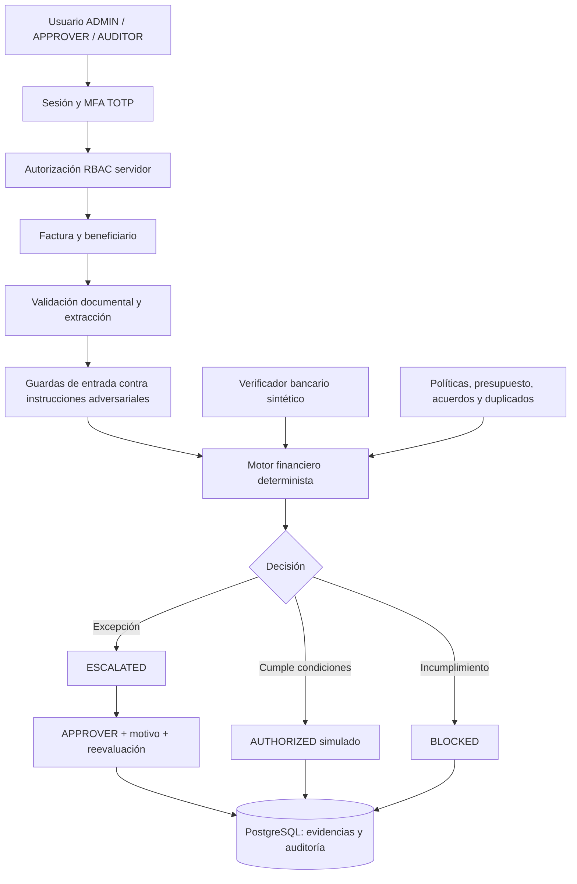

<div align="center">

# FinVigía

### Inteligencia financiera con verificación, control humano y decisiones auditables

**Plataforma experimental de control de facturas, beneficiarios y autorizaciones financieras simuladas**  
**Proyecto de investigación y desarrollo · Semillero de seguridad e inteligencia artificial**

`Next.js 16` · `React 19` · `TypeScript` · `Prisma 7` · `PostgreSQL / Neon` · `MFA TOTP`

**Datos sintéticos · Sin pagos reales · Sin validación bancaria real**

</div>

---

## 1. Resumen ejecutivo

**FinVigía** es un prototipo académico que ayuda a estudiar cómo automatizar el análisis de facturas **sin entregar el control de las autorizaciones a un modelo de IA**. Permite registrar beneficiarios y acuerdos, extraer información documental, aplicar políticas financieras, gestionar excepciones con intervención humana y conservar evidencias en PostgreSQL.

Integra dos controles relevantes para la investigación:

- **Autenticación multifactor (MFA)**: códigos temporales TOTP compatibles con Google Authenticator y otras aplicaciones, con códigos de recuperación de un solo uso.
- **Verificación bancaria sintética conectada al motor de decisiones**: exige coincidencia de datos de prueba, separación entre registro y verificación, estado vigente del beneficiario y reevaluación antes de registrar una autorización simulada.

La plataforma **no es un banco, no hace KYC/KYB real, no ejecuta desembolsos ni certifica cuentas de nómina reales**. `AUTHORIZED` solo significa **autorización dentro del sandbox**.

### Problema que aborda

La recepción de facturas, validación de proveedores, comprobación de acuerdos y aprobación de excepciones suelen depender de revisiones manuales y múltiples sistemas. Los errores pueden producir autorizaciones indebidas, duplicados, confusión en importes y ausencia de trazabilidad. FinVigía explora un flujo donde la IA **extrae información no confiable**, mientras un motor de reglas independiente toma decisiones basadas en datos y permisos del servidor.

### Objetivos del semillero

1. Evaluar la eficacia de reglas y verificación bancaria simulada para impedir autorizaciones indebidas.
2. Investigar técnicas de defensa frente a *prompt injection* y datos financieros manipulados.
3. Medir falsos positivos, falsos negativos, cobertura y tiempo de respuesta de mecanismos de control.
4. Construir una aplicación reproducible y auditable, sin depender de servicios cloud pagos para la seguridad básica.

## 2. Capacidades implementadas

| Módulo | Capacidades | Estado |
| --- | --- | --- |
| Usuarios y acceso | Contraseñas derivadas con `scrypt`, cookies `HttpOnly`, sesiones revocables | Implementado |
| MFA | TOTP de seis dígitos y 30 segundos; recuperación de un solo uso | Implementado |
| RBAC | `ADMIN`, `APPROVER`, `AUDITOR`; comprobación del lado del servidor | Implementado |
| Facturas | Registro, extracción de texto, PDF e imágenes según configuración | Implementado |
| IA documental | API OpenAI opcional; heurísticas gratuitas para texto sin clave | Implementado con limitaciones |
| Motor financiero | Políticas, duplicados, presupuesto, acuerdos, estados de beneficiarios | Implementado |
| Aprobación humana | Justificación, roles y reevaluación de condiciones | Implementado |
| Directorio de beneficiarios | Altas, acuerdos, estados y revisión | Implementado |
| Cuentas bancarias | Simulador con `SYNTHETIC_MATCH`, `SYNTHETIC_MISMATCH`, `UNKNOWN` | Implementado; **solo ficticio** |
| Defensa de entrada | Limitación de solicitudes JSON, firmas binarias de archivo, reglas básicas de prompt injection | Parcial |
| Auditoría | Eventos persistentes de cambios y decisiones en Neon | Implementado; no inmutable |
| Clasificador ML de ataques | Modelo local y evaluación comparativa | **Pendiente** |
| WebAuthn/passkeys | Segundo factor resistente al phishing | **Pendiente** |
| Integración bancaria real | Existencia/titularidad mediante API autorizada | **Fuera del prototipo actual** |

### Resultados del motor

- `AUTHORIZED`: autorización **simulada** cuando se cumplen todos los controles obligatorios.
- `BLOCKED`: una o varias reglas obligatorias impiden autorizar.
- `ESCALATED`: la solicitud necesita revisión o aprobación humana. El sistema puede representar también estados internos de aprobación requerida.

**Una respuesta del LLM nunca ejecuta una transferencia ni debe activar una autorización por sí sola.**

## 3. Stack tecnológico

| Capa | Tecnología | Responsabilidad |
| --- | --- | --- |
| Frontend | Next.js 16 App Router, React 19, TypeScript, Tailwind CSS 4 | Navegación, formularios, visualización |
| Backend | Route Handlers de Next.js en Node.js | Control de acceso, casos de uso, políticas |
| ORM | Prisma 7, adaptador `@prisma/adapter-pg` | Acceso tipado y transacciones |
| Persistencia | PostgreSQL (Neon en esta implementación) | Usuarios, sesiones, facturas, decisiones, auditoría |
| Autenticación | Contraseñas `scrypt`, TOTP RFC 6238, códigos de recuperación | Identidad y segundo factor |
| Protección de secretos | Node.js `crypto` / AES-256-GCM / HMAC-SHA-256 | Secretos MFA y datos bancarios sintéticos |
| Extracción documental | Heurísticas y OpenAI Responses API (opcional) | Campos estructurados del documento |
| Reglas de riesgo | Lógica determinista y guardas de texto | Evitar que la IA determine las autorizaciones |
| Validación | Pruebas Node, TypeScript, ESLint, scripts smoke | Regresión, tipos y pruebas funcionales |

**Costo:** el desarrollo puede hacerse localmente sin Azure. Neon ofrece un plan gratuito sujeto a cuotas; la API de OpenAI **puede generar cargos**. La extracción local de texto no exige una clave de OpenAI; los PDF/imágenes sí la requieren en la versión actual.

## 4. Arquitectura funcional



El sistema persiste las entidades operativas en Neon. Algunos módulos antiguos de demostración conservan almacenamiento local en navegador; **no deben considerarse fuente de verdad para autorización financiera**.

### Directorios principales

```text
frontend/
├── app/
│   ├── api/
│   │   ├── auth/session/               # Inicio/cierre y estado de sesión
│   │   ├── auth/mfa/enroll/            # Alta y confirmación de TOTP
│   │   ├── auth/mfa/verify/            # Segundo factor del inicio de sesión
│   │   ├── banking/accounts/           # Registro y verificación sintética
│   │   ├── invoices/                   # Facturas y expedientes
│   │   ├── approvals/                  # Resolución de excepciones
│   │   └── workspace/                  # Políticas y beneficiarios
│   ├── facturas/ · beneficiarios/ · aprobaciones/ · auditoria/ · politicas/
│   └── layout.tsx · icon.svg
├── src/
│   ├── components/                     # Frontend
│   ├── lib/                            # Reglas, verificaciones, compatibilidad
│   ├── server/
│   │   ├── security/                   # Auth, MFA, limitadores, cifrado y roles
│   │   ├── workflows/                  # Motor, banca, facturas y auditoría
│   │   └── db/                         # Prisma Client
│   ├── styles/
│   └── types/
├── prisma/
│   ├── schema.prisma
│   └── migrations/                    # Migraciones históricas conservadas
├── scripts/                            # Seed, bootstrap y smoke tests
├── tests/                              # Suite automatizada
├── public/demo/facturas/              # Documentos 100 % sintéticos
├── docs/                               # Guías técnicas por fase
├── .env.example
├── .env.auth.example
└── README.md
```

## 5. Requisitos de desarrollo

- macOS, Linux o Windows con terminal compatible.
- **Node.js 22 o superior compatible con Next.js 16** (recomendado Node 22 LTS).
- Corepack y **Yarn 4.14.1** según `packageManager`.
- PostgreSQL accesible; se utilizó Neon para el proyecto.
- `openssl` para generar claves aleatorias, y opcionalmente `curl`/Python 3 para los smoke tests.
- Al menos dos usuarios diferentes para probar la separación de funciones (`ADMIN` y `APPROVER`).

### Instalación

Desde la carpeta `frontend`:

```bash
corepack enable
corepack yarn install --immutable
```

> Si la instalación en Vercel indica `yarn v1.22.x`, revisa el reconocimiento de Corepack y del lockfile v4. No conviertas automáticamente `yarn.lock` a Yarn Classic. Para el build del proyecto se utiliza el script `yarn build`.

## 6. Configuración de variables de entorno

Copia `.env.example` a `.env` y reemplaza **todos los valores de ejemplo**. No incluyas credenciales en el repositorio ni en capturas.

```bash
cp .env.example .env
openssl rand -hex 32  # AUTH_THROTTLE_SECRET, secreto aleatorio
openssl rand -hex 32  # FINVIGIA_MFA_KEY, distinto del anterior
openssl rand -hex 32  # FINVIGIA_BANK_DATA_KEY, distinto de los anteriores
```

| Variable | Obligatoria | Función |
| --- | :---: | --- |
| `DATABASE_URL` | Sí | Conexión PostgreSQL de aplicación; en Neon puede usar pooler |
| `DIRECT_URL` | Sí para CLI | Conexión directa para migraciones, seed y bootstrap |
| `AUTH_THROTTLE_SECRET` | Sí en producción | Seudonimización HMAC de intentos de inicio de sesión |
| `FINVIGIA_MFA_KEY` | Sí para MFA | Clave hexadecimal de 32 bytes para cifrar los secretos TOTP |
| `FINVIGIA_BANK_DATA_KEY` | Sí para banca sintética | Clave hexadecimal de 32 bytes, independiente de MFA |
| `FINVIGIA_BANK_MODE` | Sí para demo bancaria | `synthetic` |
| `FINVIGIA_ALLOW_SYNTHETIC_DECISIONS` | Sí para habilitar sandbox | `true` solo con datos ficticios; `false` para deshabilitar |
| `FINVIGIA_DEMO_ORGANIZATION_SLUG` | Opcional | Identificador de organización; predeterminado `atlas-global-demo` |
| `OPENAI_API_KEY` | No | Permite extracción de PDF e imágenes; potencialmente de pago |
| `OPENAI_EXTRACTION_MODEL` | No | Modelo de extracción, predeterminado `gpt-4.1-mini` |

**Precauciones:**

- `DATABASE_URL` y `DIRECT_URL` deben corresponder **a la misma rama y base de datos de Neon**.
- Las claves MFA y banca deben ser **diferentes**, persistentes, privadas y respaldadas en un gestor de secretos. **No las regeneres al desplegar.**
- Si **ya tienes MFA configurado y cuentas cifradas**, reutiliza los **mismos valores hexadecimales de la instalación anterior**; únicamente cambia el nombre de la variable. Una clave diferente impediría descifrar datos existentes.
- El proyecto admite temporalmente las variables heredadas del despliegue anterior. Si defines el nombre nuevo y el anterior, sus valores deben coincidir o el sistema rechazará esa configuración. Este mecanismo mantiene compatibles las bases existentes; no es rotación de claves.
- El secreto `AUTH_THROTTLE_SECRET` permanece con el mismo nombre. Nunca lo publiques.
- Desactiva las autorizaciones sintéticas en entornos que no sean de demostración.

### Variables de usuarios iniciales (solo bootstrap)

Si es la **primera** instalación, copia `.env.auth.example` a `.env.auth.local`, configura tres correos diferentes y contraseñas privadas fuertes:

```bash
cp .env.auth.example .env.auth.local
```

- `FINVIGIA_ADMIN_EMAIL` / `FINVIGIA_ADMIN_PASSWORD`
- `FINVIGIA_APPROVER_EMAIL` / `FINVIGIA_APPROVER_PASSWORD`
- `FINVIGIA_AUDITOR_EMAIL` / `FINVIGIA_AUDITOR_PASSWORD`

No ejecutes bootstrap si ya creaste estos usuarios: **modifica las contraseñas y revoca sesiones existentes**. Estas variables son de aprovisionamiento; no se necesitan para operar las sesiones en Vercel.

## 7. Inicialización de PostgreSQL

**Utiliza una rama de desarrollo o prueba de Neon para aplicar cambios y ejecutar scripts de demostración.**

```bash
yarn db:generate
yarn db:deploy
yarn db:status
```

Las migraciones del repositorio incluyen el esquema inicial, la limitación distribuida de intentos y las entidades MFA/bancarias. **Renombrar el proyecto no requiere renombrar las tablas ni recrear la base de datos.** Prisma mantiene las relaciones existentes.

Solo en una base de demostración nueva:

```bash
yarn db:seed
# Carga .env.auth.local en tu shell antes de ejecutar lo siguiente:
set -a
source .env.auth.local
set +a
yarn auth:bootstrap
```

Para iniciar:

```bash
yarn dev
```

Abre [http://localhost:3000](http://localhost:3000).

## 8. Roles y permisos

| Acción | ADMIN | APPROVER | AUDITOR |
| --- | :---: | :---: | :---: |
| Consultar expedientes y auditoría | Sí | Sí | Sí |
| Registrar / verificar facturas | Sí | No | No |
| Ejecutar evaluación financiera simulada | Sí | No | No |
| Crear/editar beneficiarios y políticas | Sí | No | No |
| Registrar cuenta bancaria sintética | Sí | No | No |
| Verificar la cuenta registrada por otro usuario | No | Sí | No |
| Resolver aprobaciones humanas | No | Sí | No |

Las restricciones se verifican en endpoints. El estado `AUTHORIZED` nunca debe confundirse con un pago ejecutado.

## 9. Autenticación multifactor

1. Inicia sesión con las credenciales de un usuario de demostración.
2. Si no tiene MFA, la aplicación ofrece la activación obligatoria.
3. Agrega manualmente la cuenta a Google Authenticator, Aegis o un autenticador TOTP equivalente.
4. Configura **SHA-1, seis dígitos, intervalo de 30 segundos**.
5. Confirma el código y guarda los **ocho códigos de recuperación** en un lugar privado.
6. Al volver a iniciar sesión, la plataforma solicita el segundo factor.

**Controles de MFA presentes:**

- Ventana TOTP con tolerancia acotada y rechazo de intervalos reutilizados.
- Secretos cifrados mediante AES-256-GCM.
- Desafíos temporales con límite de intentos.
- Códigos de recuperación almacenados como resúmenes y consumidos una sola vez.
- Cookies `HttpOnly`, `Secure` en producción y `SameSite`.

**Compatibilidad tras el cambio de nombre:** los códigos TOTP **ya activados siguen siendo válidos** si mantienes la misma clave de cifrado. La cuenta que aparece en Google Authenticator puede conservar el nombre anterior; es una etiqueta visual, no cambia el algoritmo ni el secreto. Las cuentas nuevas se enrolan con el emisor **FinVigía**. No borres la cuenta antigua del autenticador sin confirmar que conservas acceso y códigos de recuperación.

## 10. Verificación bancaria sintética y control de nómina

El módulo de prueba **no consulta entidades financieras**. El proveedor ficticio contiene ejemplos como:

| Banco ficticio | Cuenta ficticia | Tipo | Titular ficticio |
| --- | --- | --- | --- |
| `BANK-DEMO-A` | `TEST-ACCOUNT-0001` | `PAYROLL` | `PERSON-DEMO-0001` |
| `BANK-DEMO-A` | `TEST-ACCOUNT-0002` | `SAVINGS` | `PERSON-DEMO-0002` |
| `BANK-DEMO-B` | `TEST-ACCOUNT-0003` | `CHECKING` | `PERSON-DEMO-0003` |

**Flujo de demostración:**

1. `ADMIN` crea o selecciona un beneficiario en `/beneficiarios`.
2. `ADMIN` registra una cuenta sintética: el estado pasa a `PENDING` y el beneficiario a `REVIEW`.
3. Otro usuario con rol `APPROVER` entra mediante MFA y verifica esa cuenta.
4. El simulador responde `SYNTHETIC_MATCH`, `SYNTHETIC_MISMATCH` o `UNKNOWN`.
5. `ADMIN` autoriza al beneficiario solo cuando se cumplen los requisitos del sandbox.
6. El motor comprueba la **versión vigente del beneficiario y de su cuenta** en la evaluación y de nuevo en la resolución de excepciones.
7. Al cambiar datos bancarios, se invalida la verificación previa; nuevas decisiones deben bloquearse hasta repetir la revisión.

**Protección de datos:** referencias de cuenta y titular ficticios están cifradas, se exponen enmascaradas y se registran cambios en auditoría. `realBankConfirmed` permanece `false`: **ni siquiera un resultado `SYNTHETIC_MATCH` acredita la existencia de una cuenta bancaria**.

## 11. Facturas, extracción de IA y políticas

### Ingesta

- Texto: si no hay `OPENAI_API_KEY`, se usa extracción heurística local.
- PDF/PNG/JPG/WEBP: la versión actual necesita la API de OpenAI para extraer contenido; no hay OCR local implementado.
- El sistema limita el tamaño de los archivos, comprueba la extensión/MIME y valida cabeceras binarias. **No incorpora un antivirus completo**.
- Las señales textuales sospechosas de inyección pueden bloquear la extracción. Esto **no equivale** a un detector ML robusto: sigue siendo un control preventivo basado en reglas.

### Políticas

La política semilla de demostración usa USD y configura inicialmente:

- Umbral autónomo: **USD 1.000**.
- Límite absoluto: **USD 5.000**.
- Presupuesto mensual: **USD 10.000**.

El motor contrasta duplicados, condiciones documentales, beneficiarios, acuerdos, estado bancario simulado y capacidad presupuestaria. Las operaciones que necesitan revisión se escalan y pueden resolverse por `APPROVER` con justificación, sin eludir reglas que bloquean.

### Dataset de pruebas

Se incluyen **14 documentos sintéticos** en `public/demo/facturas/` y un `manifest.json` con SHA-256. Los casos abarcan factura elegible, aprobación humana, duplicados, beneficiario no permitido, límite de acuerdo, límite absoluto, moneda diferente, información incompleta, prompt injection y formatos de imagen/texto.

**La certificación automática de documentos es exclusiva del conjunto sintético conocido** y exige coincidencia de hash y campos. Un archivo desconocido o manipulado no recibe certificación automáticamente.

## 12. Rutas de aplicación y API

### UI

| Ruta | Pantalla |
| --- | --- |
| `/` | Dashboard y centro de decisiones |
| `/beneficiarios` | Proveedores, acuerdos y cuentas sintéticas |
| `/facturas` | Ingesta, listado y procesamiento |
| `/facturas/[id]` | Expediente de factura |
| `/aprobaciones` | Revisión humana |
| `/politicas` | Gobierno de reglas |
| `/auditoria` | Timeline y exportación de eventos |

### Endpoints principales

| Endpoint | Propósito |
| --- | --- |
| `GET/POST/DELETE /api/auth/session` | Estado, login y logout |
| `POST /api/auth/mfa/enroll` | Iniciar o confirmar alta TOTP |
| `POST /api/auth/mfa/verify` | Completar desafío de inicio de sesión |
| `POST /api/banking/accounts` | Registrar o verificar cuenta ficticia según rol |
| `/api/invoices` y rutas hijas | Ingesta, extracción, verificación, evaluación |
| `POST /api/approvals/[id]/resolve` | Resolver aprobación con revisión de políticas |
| `/api/workspace` y `/api/workspace/actions` | Consulta y mutaciones del workspace |

**No se recomienda invocar APIs sensibles sin sesión MFA y la autorización correspondiente.** Los POST requieren origen válido; las respuestas sensibles no se almacenan en caché.

## 13. Calidad, pruebas y comandos

Desde la carpeta `frontend`:

```bash
yarn test:rules
yarn typecheck
yarn lint
yarn build
```

| Comando | Función |
| --- | --- |
| `yarn dev` | Servidor local |
| `yarn build` | Generar Prisma Client y compilar producción |
| `yarn start` | Servir compilación de producción |
| `yarn test:rules` | Suite de reglas, contratos y regresión |
| `yarn typecheck` | Comprobación TypeScript con Prisma generado |
| `yarn lint` | ESLint |
| `yarn db:generate` | Generar Prisma Client |
| `yarn db:deploy` | Aplicar migraciones existentes |
| `yarn db:status` | Revisar estado de migraciones |
| `yarn db:studio` | Navegador de datos de Prisma |
| `yarn db:seed` | Sembrar organización y datos sintéticos |
| `yarn auth:bootstrap` | Crear/actualizar usuarios demo; **revoca sesiones** |
| `yarn test:smoke:auth` | Smoke de autenticación con usuario de prueba |
| `yarn test:smoke:integration` | Smoke que crea registros de prueba |
| `yarn test:smoke:neon` | Smoke de conexión y operaciones |

**Validación de esta entrega:** 124 pruebas automatizadas ejecutadas correctamente después del renombrado. No se debe interpretar como auditoría de seguridad ni como garantía de que el despliegue está listo: faltan ejecutar `typecheck`, `lint`, `build` y las pruebas de integración en el entorno final.

Los smoke tests afectan la base a la que apuntan las variables. **Ejecútalos únicamente sobre una rama de prueba de Neon**.

## 14. Despliegue en Vercel

1. Sube el código a un repositorio sin `.env`, claves, datos reales ni sesiones.
2. Conecta el repositorio a Vercel y utiliza Next.js como framework.
3. Comprueba que se use **Yarn 4** con el lockfile aportado. No mezcles Yarn Classic con Yarn Berry.
4. Configura las variables de entorno en **Project Settings → Environment Variables**, con los mismos valores de cifrado que utilizas para la base persistida.
5. Aplica las migraciones una sola vez y de forma controlada contra la rama elegida:

```bash
yarn db:generate
yarn db:deploy
```

6. Ejecuta `yarn typecheck`, `yarn lint` y `yarn build` antes de publicar.
7. Valida desde el dominio desplegado: login, MFA, separación de roles, verificación de beneficiario, bloqueo por cambio de cuenta, auditoría.

No ejecutes `seed`, `bootstrap` ni migraciones en cada build. Nunca expongas `OPENAI_API_KEY`, las claves de cifrado o credenciales de cuentas demo al frontend.

**Atención a dominio/cookies:** los navegadores asocian cookies al dominio. Un cambio de dominio requiere nuevo login; el TOTP existente continúa válido si las claves y la base se mantienen.

## 15. Protección, amenazas y riesgos residuales

### Controles existentes

- Verificación RBAC por ruta del servidor y sesión asociada a identidad.
- TOTP y códigos de recuperación; desafío limitado en intentos/tiempo.
- Limitación distribuida de intentos de contraseña usando PostgreSQL.
- Cifrado autenticado de secretos y datos bancarios sintéticos.
- Revalidación de condiciones financieras antes de confirmar operaciones.
- Validación de tamaño y firma de documento; lectura JSON acotada.
- Cabeceras HTTP de seguridad y CSP de compatibilidad.
- Eventos de auditoría y snapshots financieros.

### Pendientes antes de operar fuera del semillero

- WebAuthn/passkeys y recuperación de cuenta con proceso de soporte seguro.
- Clasificador dedicado de prompt injection + métricas y pruebas adversariales.
- Antimalware real, sandbox para PDFs y controles de salida de la IA.
- CSP sin `unsafe-inline`, según compatibilidad de Next.js.
- Auditoría resistente a modificaciones, alertas y respuesta a incidentes.
- Pruebas E2E, pentesting autorizado, evaluación de dependencias y *threat modeling*.
- Gestión formal de secretos, rotación, backups y restauración verificada.
- Validación bancaria real autorizada, identidad del titular y cumplimiento normativo aplicable.

**No cargues datos bancarios, documentos ni información personal reales.** Este repositorio es un sistema de demostración y de investigación.

## 16. Criterios de aceptación del semillero

- Un usuario sin MFA confirmado no accede a APIs financieras.
- `AUDITOR` no puede mutar políticas ni aprobar facturas.
- El usuario que registra una cuenta sintética no puede verificarla como segundo aprobador.
- Una cuenta sintética `UNKNOWN` o `SYNTHETIC_MISMATCH` no autoriza pagos de prueba.
- Cambiar cuenta o versión del beneficiario revoca la elegibilidad anterior.
- Una factura duplicada o fuera de políticas no se autoriza.
- Un documento con instrucciones adversariales no debe alterar roles, políticas ni decisiones.
- Los eventos conservan actor, fecha, acción, motivo y contexto suficiente.
- La aplicación sigue sin ejecutar pagos reales bajo cualquier resultado.

### Métricas recomendadas

Para la siguiente fase, registrar: *precision*, *recall*, F1, falsos positivos, falsos negativos, tasa de autorizaciones indebidas, latencia por documento y costo por análisis (si se usa un proveedor externo). Emplear un dataset sintético reproducible y separar entrenamiento de evaluación.

## 17. Cambio de nombre y continuidad de la instalación

Esta versión adopta la identidad **FinVigía** en la interfaz, el título del navegador, el icono, el emisor de **nuevas** inscripciones MFA, el paquete y la documentación.

Para evitar daños a una instalación ya operativa:

- **No cambia el esquema Prisma**, los identificadores de los usuarios ni el `slug` de la organización existente (`atlas-global-demo` sigue siendo el valor predeterminado).
- **No cambia secretos TOTP ni hashes** almacenados: las claves se descifran con el mismo material criptográfico que antes.
- Los nombres nuevos de variables usan `FINVIGIA_*`; se leen los nombres anteriores como compatibilidad temporal si los nuevos no existen.
- Las sesiones existentes conservan lectura de la cookie anterior hasta su expiración normal; los nuevos ingresos usarán `finvigia_auth_session`.
- Las claves de `localStorage` de módulos demostrativos usan el nuevo prefijo: **los datos exclusivamente locales de la antigua interfaz pueden no mostrarse**. Las entidades persistidas en Neon no se migran ni se eliminan.
- Los nombres de cuenta TOTP guardados en el móvil son etiquetas: una inscripción antigua puede seguir mostrando su emisor original.

El nombre elegido es un **nombre de trabajo académico**. No equivale a una certificación de disponibilidad marcaria o de dominio comercial.

## 18. Documentación complementaria

- [`docs/SEMILLERO_SEGURIDAD_FASE1.md`](./docs/SEMILLERO_SEGURIDAD_FASE1.md): controles de seguridad iniciales y límites.
- [`docs/SEMILLERO_SEGURIDAD_FASE2.md`](./docs/SEMILLERO_SEGURIDAD_FASE2.md): MFA, verificador sintético y guía operativa.
- [Next.js](https://nextjs.org/docs) · [Prisma](https://www.prisma.io/docs) · [OWASP ASVS](https://owasp.org/www-project-application-security-verification-standard/) · [RFC 6238](https://www.rfc-editor.org/rfc/rfc6238)

---

<div align="center">

**FinVigía · Seguridad, trazabilidad e inteligencia aplicada a decisiones financieras**

*Prototipo académico. Solo datos ficticios y decisiones simuladas.*

</div>


## Identidad visual y SEO de FinVigía

Se incluyen un favicon nuevo, `apple-icon.png`, logos SVG, iconos 192/512 y la imagen Open Graph en `public/seo/finvigia-open-graph.png`. La página pública `/proyecto` presenta el alcance académico sin exponer el panel privado. El resto de la aplicación se mantiene con `noindex`.

Antes de solicitar indexación, configura `NEXT_PUBLIC_SITE_URL` con la URL HTTPS real y estable (por ejemplo, tu dominio propio o el dominio de Vercel que usarás definitivamente). Luego comprueba `/proyecto`, `/robots.txt`, `/sitemap.xml` y `/manifest.webmanifest`. No publiques nunca las rutas privadas en el sitemap.

`GOOGLE_SITE_VERIFICATION` es opcional si verificas el dominio en Search Console. El JSON-LD describe la aplicación sin inventar reseñas, precios ni acreditaciones bancarias. Para instrucciones completas consulta `docs/SEO_FINVIGIA.md`.
